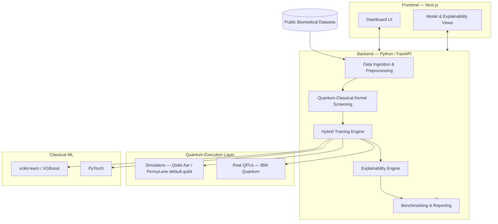

# MedQube

**A hybrid quantum–classical machine learning platform for early disease detection.**

Pioneering the intersection of Quantum Computing and Healthcare to deliver high-precision, explainable diagnostics.

## Architecture

## Tech Stack

| Layer | Choice |
|---|---|
| **Frontend** | Next.js 16 (App Router) + TypeScript |
| **Styling** | Tailwind CSS + shadcn/ui |
| **Backend** | Python 3.12+ with FastAPI |
| **Quantum ML** | PennyLane + Qiskit |
| **Classic ML** | scikit-learn, XGBoost, PyTorch |
| **Explainability** | SHAP, custom circuit attribution |

## Research Registry

The platform handles multiple clinical disease pillars, starting with Breast Cancer (FNA Cytopathology) and Cardiovascular disease (ECG imaging, blood panels).

- **v1 (Baseline)**: 8-Qubit VQC & Classical Ensemble
- **v2, v3 (Advanced)**: Iterative improvements with Noise Mitigation and Fault-Tolerant Quantum Kernels.

## Roadmap

- [ ] Finalize dataset(s) for the MVP
- [ ] Data ingestion + preprocessing pipeline
- [ ] Parallel hybrid training & benchmarking
- [ ] Quantum-native explainability layer
- [ ] Real QPU validation & results dashboard

---
*Built by Team MedQube for SIH26139.*

